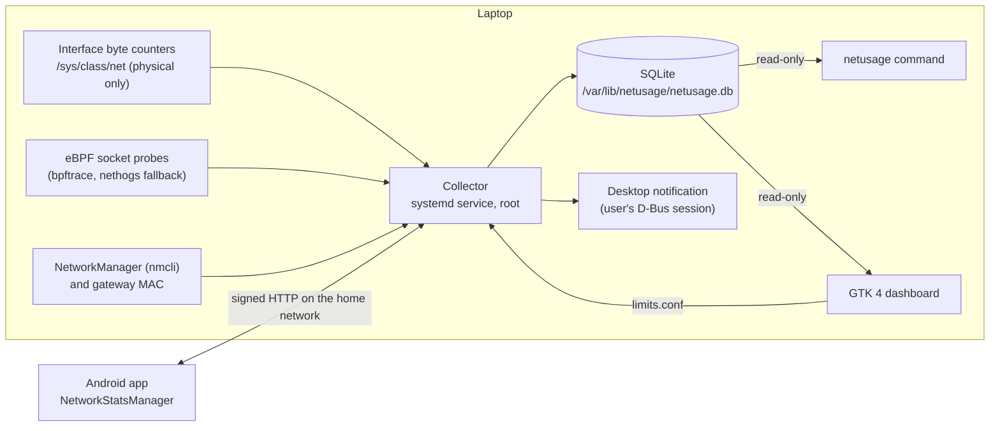

<div align="center">


# Internet Usage (netusage)

**Track how much internet a Linux laptop uses over your billing cycle, by application and by network, with an optional Android companion.**

[](https://github.com/AbdelRahman-Madboly/netusage/actions/workflows/ci.yml)


[How it works](#how-it-works) · [Install](#install) · [Usage](#usage) · [Dashboard](#dashboard) · [Phone app](#phone-app) · [What it does not do](#what-it-does-not-do)

</div>

## Why netusage

On a capped data plan you need to know where the gigabytes went before the bill arrives.
netusage tracks how much internet a Linux laptop consumes over a monthly billing cycle (the start
day is configurable), broken down by application and by network. An optional Android app adds
the phone's usage.

A background service collects continuously; a desktop dashboard and a terminal command report on
demand. The service is independent of any terminal, starts at boot, and restarts itself if it
dies. Design decisions, the bug log and open items are in [`NOTES.md`](NOTES.md).

## Highlights

- **A total you can trust.** The headline figure comes from the kernel's own byte counters for
  physical network interfaces, so docker, veth and tailscale interfaces do not inflate it, and
  reboots do not lose the day.
- **Per-application split from eBPF.** Socket-layer kprobes see QUIC, UDP and short-lived
  connections that a pcap-based tool misses, and local traffic is filtered out.
- **Per network, per router.** Wi-Fi is tracked by router (its BSSID), so renaming a network or
  changing its password keeps the same entry.
- **Daily limit and data plan warnings.** Desktop notifications at set percentages, editable from
  the dashboard with no sudo and no restart. Limits only notify; nothing is blocked.
- **Shared bill split.** `netusage bill` works out the laptop's share of what the cycle's bundles
  cost, so it can be billed to an employer or a housemate.
- **Desktop dashboard and phone app.** A GTK 4 / libadwaita dashboard that reads the database
  read-only, and a Kotlin app that adds the phone with the same pages.

## How it works



The interface total and the per-app split are collected independently and are not reconciled,
so the total still works if eBPF fails. The phone app can also read the laptop's usage from the
collector over the home network; each request is signed with a shared token that is never sent.

## Install

```sh
git clone https://github.com/AbdelRahman-Madboly/netusage.git && cd netusage
sudo ./install.sh
```

Installs `vnstat`, `bpftrace` and `nethogs`, copies the program to `/opt/netusage`, registers the
`netusage` systemd service, and links the `netusage` command into `/usr/local/bin`. Re-run it any
time to update.

## Usage

```sh
netusage           # cycle total, today, daily average, top applications
netusage today     # today only, by application
netusage apps      # every application this cycle
netusage days      # per-day table for this cycle
netusage cycles    # previous billing cycles
netusage networks  # this cycle per Wi-Fi router / wired network
netusage status    # collector health and which backend is active
netusage live      # live throughput, Ctrl-C to stop
netusage bill      # the cycle's cost and the laptop's share
```

`-n N` limits application rows; `-i N` sets the poll interval for `live`.

### Shared bill split

`netusage bill` splits what the cycle's bundles cost: the price per GB bought (total paid / GB
bought) times each device's GB on the home plan, so the laptop's share can be billed to someone
else (an employer or a housemate, say). Unused GB are not charged to the laptop.

```sh
netusage bill base 200 150 --fee 10   # every cycle comes with 200 GB for 150 (+10% fee)
netusage bill add 50 60 --fee 10      # an extra 50 GB bought this cycle
netusage bill -b 1                    # the previous cycle
netusage bill --json                  # the same as data
```

Bundles are kept in `~/.config/netusage/bills.json`, which another tool may also write. An
optional `"share_label"` key in that file renames the laptop's line on the bill (default "Laptop
share"). Below the split, the laptop's GB are grouped by kind of application. The built-in kinds
cover package managers, dev tools, browsers and system updates; add your own in
`~/.config/netusage/app_kinds.json` (see [`app_kinds.example.json`](app_kinds.example.json)),
which is checked first.

## Dashboard

```sh
./install-gui.sh             # as your normal user, no sudo
./install-gui.sh --remove    # take it off again
```

Installs an **Internet Usage** launcher on the desktop and in the applications menu. It is a
GTK 4 / libadwaita app that reads the collector's database read-only, so it needs no root and
cannot disturb collection. It refreshes every 10 seconds.

| Page | What it shows |
|---|---|
| **Overview** | Pick Day, Week, Month, Cycle or All time, and step back with the arrows. Cards show the period total with the download/upload split, today against the daily limit as a ring, the billing cycle with its reset date and projection, and live throughput for the last minute. Below are a stacked download/upload chart (hourly for a day, daily for a week, month or cycle, monthly for all time; click a bar to open that day or month), a cumulative view with an even-pace line, and the top applications. |
| **Apps** | Every application in the period, searchable and sortable, with a "new" badge on anything first seen in that period. Click one for its daily history, share and rank. |
| **Networks** | Usage per network in the period. Wi-Fi is tracked by router (its BSSID), so renaming a network or changing its password keeps the same entry, with every name it has had listed under it; the router's 2.4 GHz and 5 GHz radios count as one. Wired networks are tracked by the gateway's MAC address. Click one for its daily chart, to give it your own name, or to merge it with another network (a second router at the same place, say). Traffic from before this was installed shows as "Before network tracking". |
| **History** | Billing cycles side by side, a year-long calendar of daily usage with over-limit days in red, the ten busiest days and totals by month. |
| **Status** | Collector health, backend, counted interfaces, data range and per-app coverage, plus copyable commands for when something is wrong. A banner appears on every page if the collector stops reporting. |

Week means the seven days ending on the chosen day, not a calendar week.

Preferences (Ctrl+,) sets the notifications, with no sudo and no restart:

- **Daily limit** in GB, and which percentages of it notify you (50, 80, 90, 100, 150, 200).
- **Monthly data plan** in GB for the billing cycle, with its own percentages (50, 75, 90, 100).
  With a plan set, the cycle card also shows remaining data, a safe amount per day for the rest
  of the cycle and an on-track / fast pace / over plan marker, and the cumulative chart draws the
  plan as a line.
- **Reminders**: once past a limit, repeat the notification every 15 min to 4 hours until the day
  or cycle ends.
- **Send a test notification** to check they show up.

These are saved to `/var/lib/netusage/limits.conf`, which `install.sh` creates owned by you. The
collector re-reads it whenever it changes, so edits apply within one interval, and its values
override `daily_limit_gb` and `notify_at` in `/etc/netusage.conf`. Raising or lowering a limit
re-arms its thresholds for the rest of the day or cycle. The cycle start day still comes from
`/etc/netusage.conf`.

Menu: export the current period as CSV (per-day and per-app bytes), copy a text summary.
Keyboard: Alt+1..5 period, Alt+Left/Right step, Home current period, Ctrl+1..5 page, Ctrl+F
search apps, Ctrl+R refresh, Ctrl+? all shortcuts.

Editing files in this folder changes nothing until `./install-gui.sh` is run again; it copies the
program to `~/.local/share/netusage-dashboard`.

## Daily limit

The daily limit is 10 GB, set in `/etc/netusage.conf`. When today's usage crosses 80%, 100%, 150%
and 200% of it, a desktop notification appears; the 100% one is marked critical so it stays on
screen. Each threshold fires at most once per day, and which ones have fired is recorded in the
database, so restarting the service mid-day does not replay notifications you already saw.
Crossing several thresholds at once produces one notification, not several.

`netusage` and `netusage today` show today's usage against the limit with a bar that turns yellow
at 80% and red once exceeded.

The collector runs as root, which has no desktop session of its own, so it hands the
notification to the logged-in user's D-Bus session explicitly. If nobody is logged in, the
threshold is still recorded and simply not shown.

Set `daily_limit_gb = 0` to switch notifications off while still tracking usage. The limit is a
warning only; nothing is throttled or blocked.

## Phone app

[`android/`](android) is the same tool for an Android phone (Kotlin, Jetpack Compose), with the
same icon and pages: Overview, Networks, Apps, History, Settings.

- Totals and per-app numbers come from Android's own network history (`NetworkStatsManager`),
  copied into the app's database every 30 minutes and whenever it is open, so they outlive the
  three months Android keeps.
- A small always-on tracker notes which Wi-Fi router (by BSSID, as above) or which SIM was
  connected, and each hour's exact total is shared out between them. Needs Usage access,
  location "all the time" (Android hides the Wi-Fi name and BSSID without it), phone and
  notifications.
- Data plan and daily limit with warnings, per SIM, per router or overall.

Build and install from this laptop with the phone plugged in:

```sh
cd android
./gradlew assembleRelease
# --user 0: only the main profile; without it Samsung also installs into Dual Apps
adb install -r --user 0 app/build/outputs/apk/release/app-release.apk
```

`android/tools/build_import.py` builds a one-off `assets/import.json` with history from before
the app existed: Android's hourly per-network history read over adb (`dumpsys netstats`), and
daily and weekly per-app totals read from My Data Manager's screens. That file holds personal
data and is kept out of git.

## How the numbers are produced

**The headline total** comes from the kernel's own byte counters for physical network
interfaces, read every 10 seconds and stored as per-day deltas.

- It does not matter which WiFi network you are on. Home, a phone hotspot, a café: all of it
  lands in the same total, because the counter belongs to the interface, not the network.
- Only physical interfaces are counted. This machine has around 23 virtual ones (`docker0`,
  `br-*`, `veth*`, `tailscale0`); counting those would inflate the total badly, and Tailscale in
  particular would be counted twice since its traffic already rides over the WiFi adapter.
  Physical interfaces are identified by the presence of `/sys/class/net/<name>/device`.
- Reboots are handled: the last raw counter value is checkpointed to the database, so when a
  counter restarts from zero the collector recognises the reset instead of recording a huge
  negative or losing the day.
- The same deltas are also stored per hour in `iface_hourly`, keyed by local time as
  `YYYY-MM-DD HH` (`2026-09-28 14`), for a "today by hour" view. A delta covering a gap (the
  first sample after a reboot or restart) lands in the hour it was read, as it does for the day.

**The per-network breakdown** files the same interface deltas under the network they went over.
Every 30 seconds the collector asks NetworkManager (`nmcli`) which access point a wireless
interface is on, or looks up the MAC of a wired interface's default gateway. The key for a router
is its BSSID without the first and last octets, which are the parts that differ between one
router's radios; the phone app uses the same key, so a router shows up under the same identity on
both. Names and merges set in the dashboard live in `/var/lib/netusage/networks.json`, owned by
you like `limits.conf`.

**The per-application breakdown** comes from eBPF kprobes on the socket send/receive paths
(`tcp_sendmsg`, `tcp_cleanup_rbuf`, `udp_sendmsg`, `udp_recvmsg`), aggregated inside the kernel
and dumped every 10 seconds. Because this sits at the socket layer rather than sniffing packets,
it sees QUIC, UDP and short-lived connections that a pcap-based tool misses.

The socket layer also sees traffic that never reaches a network card: loopback (a local
database, dev servers, test runners), the docker bridge and the tailscale tunnel.
`probe_filtered.bt` drops it by checking the route each socket has cached and keeping only
sockets whose route leaves through a counted physical interface. Tailscale traffic is then
counted once, under `tailscaled`, as the encrypted packets it sends over WiFi. A VPN that uses a
tun device behaves the same way: its traffic lands under the VPN daemon, not the app. Inside a
container, where interface numbers belong to the container, loopback and private (10/8,
172.16/12, 192.168/16) peers are dropped and everything else is counted.

Per-app rows recorded before the filtered probe first ran include local traffic and cannot be
corrected after the fact. The first day it ran is kept in the database (`meta.app_filter_since`)
and shown by `netusage status`.

These two numbers do not match exactly, and are not meant to. Per-app figures are payload bytes:
they exclude TCP/IP headers, TLS framing and retransmits, so they typically account for 90-95% of
the interface total. `netusage` prints the coverage percentage so the gap is always visible.
**The interface total is the number to trust for consumption**; the per-app figures show the
split.

Sizes use 1024-based units, the same convention `vnstat` and most Linux tools use. If your
provider quotes GB as 1,000,000,000 bytes, their figure will read about 7% higher than this one.

## What it does not do

- It does not block, shape or limit traffic. Limits only notify.
- It does not read the ISP's meter. The remaining balance comes from readings typed into the
  dashboard's ISP dialog, and bundle prices come from `netusage bill add` or the bills file.
- It counts only this laptop and the phones that run the phone app. Other devices on the home
  network are not seen.
- It is built for Ubuntu with systemd. The collector needs root for eBPF; nothing is packaged for
  other distributions.

## Limitations

- Traffic inside a Docker container is attributed to the container's process as seen from the
  host, so several containers may aggregate under `docker`.
- Per-app attribution needs the process to still exist when a batch is flushed. A process that
  sends data and exits within the same 10-second window is recorded under its kernel `comm` name
  rather than a full one.
- The collector claims no traffic for an interface the first time it sees it, since the counter
  already holds history it cannot attribute to this cycle.

## Status

v1.0.0 plus the unreleased changes in [CHANGELOG.md](CHANGELOG.md). Built as a personal tool and
used daily on one Ubuntu 24.04 laptop and one Android phone; the collector, the `netusage`
command, the dashboard and the phone app work end to end there. The two Python test scripts and
the phone app's unit tests pass. It has not been tried on other distributions or kernels, and the
filtered eBPF probe depends on kernel struct layouts.

## Tests

No root and no display needed; the eBPF probes themselves are not run, only the parsing and
accounting around them. CI runs all three (`.github/workflows/ci.yml`).

```sh
python3 test_netusage.py   # collector, classifier, limits, CLI formatting, bill command
python3 test_data.py       # dashboard query layer, periods, networks, bill split
cd android && ./gradlew test assembleDebug
```

## Reference

<details>
<summary><b>Configuration</b>: <code>/etc/netusage.conf</code></summary>

```ini
[general]
interfaces     = auto      ; or a comma-separated list
cycle_day      = 25        ; day of month the billing cycle starts (1 to 28)
interval       = 10        ; seconds between samples
db             = /var/lib/netusage/netusage.db
backend        = auto      ; auto | ebpf | nethogs | off
daily_limit_gb = 10        ; 0 disables notifications
notify_at      = 80,100,150,200
```

An optional `[aliases]` section reports extra executable names under one name
(`helper-binary = tool-name`), for tools that run several helpers.

After editing: `sudo systemctl restart netusage`.

Changing `cycle_day` re-slices existing history rather than discarding it, because usage is
stored per day and the cycle is only a date range over it.

</details>

<details>
<summary><b>Backends</b>: how per-application accounting is chosen</summary>

Per-application accounting picks the first that works:

1. `probe_filtered.bt`: eBPF with the physical-interface filter described above, using the map
   print format. The collector fills in the interfaces' `ifindex` values at start-up, so an
   adapter plugged in later is outside the filter until `sudo systemctl restart netusage`. If it
   fails to attach within 15 seconds, the unfiltered probes below take over.
   This probe has been checked against the kernel's type data but not yet seen attaching on a
   real machine; `netusage status` shows whether it did.
2. `probe_for.bt`: eBPF iterating the map with `for`, which needs **bpftrace 0.21**. Ubuntu 24.04
   ships 0.20.2, so this is skipped here: the installed version is checked first rather than
   attempted and logged as a syntax error on every start.
3. `probe_print.bt`: eBPF using the map print format, unfiltered.
4. `nethogs`: pcap-based fallback

`netusage status` reports which is active ("physical NICs only" for the filtered probe). If all
fail, the interface total still works: it does not depend on eBPF at all.

</details>

<details>
<summary><b>Service</b>: status, logs, restart</summary>

```sh
systemctl status netusage      # is it running
journalctl -u netusage -f      # what is it doing
sudo systemctl restart netusage
```

`vnstat` is installed alongside as an independent cross-check on the interface totals
(`vnstat -m`); nothing in netusage depends on it.

</details>

<details>
<summary><b>Files</b>: where everything is installed</summary>

| Path | Purpose |
| --- | --- |
| `/opt/netusage/` | installed program |
| `/etc/netusage.conf` | configuration |
| `/var/lib/netusage/netusage.db` | usage history (SQLite): `iface_daily`, `iface_hourly`, `app_daily`, `meta` |
| `/etc/systemd/system/netusage.service` | service unit |
| `/usr/local/bin/netusage` | the command |
| `~/.local/share/netusage-dashboard/` | installed dashboard |
| `~/.local/share/applications/com.madboly.NetUsage.desktop` | menu entry (a copy sits on the desktop) |
| `/var/lib/netusage/limits.conf` | notification limits, editable from the dashboard |
| `~/.config/netusage/dashboard.json` | dashboard preferences |

</details>

<details>
<summary><b>A note on probe widths</b></summary>

The kernel receive paths (`tcp_cleanup_rbuf`, `udp_recvmsg`) hand back a 32-bit `int`. Reading
those as 64-bit values picks up whatever the caller left in the high word, which yields byte
counts that are exact multiples of 2^32: figures like "376.00 GB" appearing within minutes of
starting. Both are cast to `int32` before use. The send paths take a `size_t` and need no cast,
which is why upload figures were correct while downloads were not.

As a backstop, any single batch claiming more than 64 GiB for one process is discarded rather
than recorded, so a future kernel ABI change degrades into missing data instead of nonsense
totals.

</details>

<details>
<summary><b>Cost</b>: CPU and disk</summary>

Roughly 0.2% of one CPU core, with bpftrace accounting for most of it. The collector wakes once
per `interval`, writes a handful of rows and goes back to sleep; it is niced and set to idle I/O
priority so it yields to anything else wanting the disk.

`python3 test_netusage.py` includes a check that the collector stays under 5% of a core, because
a busy loop here is invisible in the recorded totals: the numbers stay correct while the CPU
burns.

</details>

## Uninstall

```sh
sudo ./uninstall.sh            # keeps the database
sudo ./uninstall.sh --purge    # deletes it too
```

## Repository layout

| Path | Contents |
|---|---|
| `collector.py`, `netusage.service`, `netusage.conf` | The collector, its systemd unit and default configuration |
| `probe_filtered.bt`, `probe_for.bt`, `probe_print.bt` | The bpftrace programs for per-app accounting |
| `cli.py` | The `netusage` command |
| `netusage_data.py`, `gui/` | Dashboard query layer and the GTK 4 dashboard |
| `install.sh`, `install-gui.sh`, `uninstall.sh` | Install and remove |
| `test_netusage.py`, `test_data.py` | Python tests |
| `android/` | The phone app |
| `NOTES.md` | Design decisions, bug log, open items |

## License

MIT, see [LICENSE](LICENSE).

## Author

Designed and built by **Abdel Rahman Mohamad EL-Sayed** ([@AbdelRahman-Madboly](https://github.com/AbdelRahman-Madboly)).
